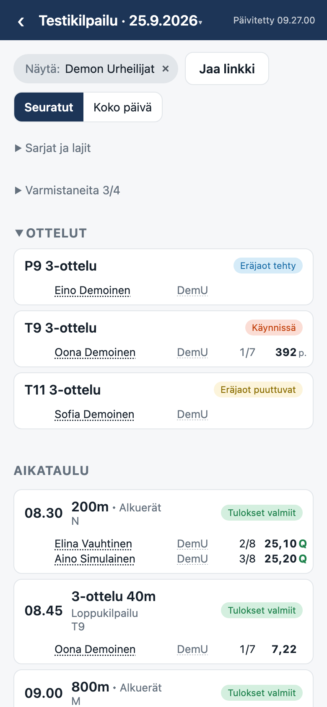
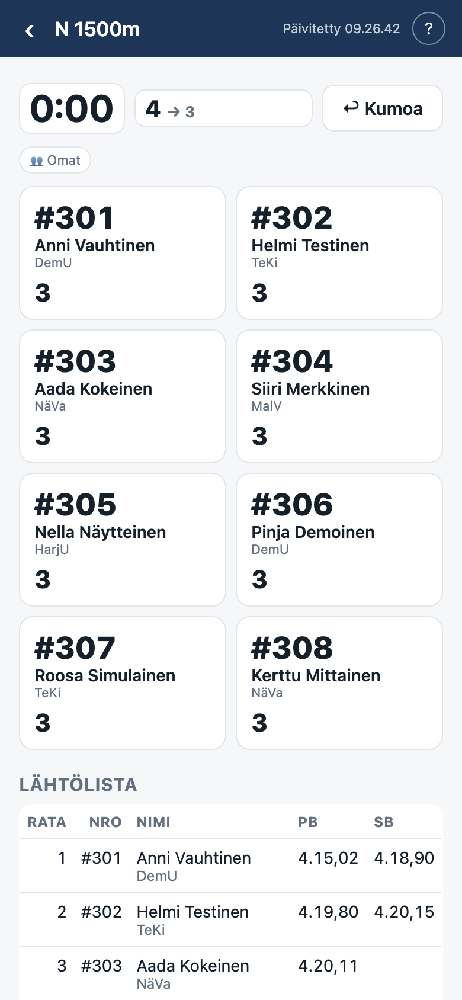

# Kisat

Kisat shows Finnish athletics competitions to the people who follow a club or a few athletes. It
reads the schedules and results that [Tuloslista](https://live.tuloslista.com/) publishes, track and
field together. It works on a phone at the track and on a laptop at home. The same code serves
Juoksut, a mode for the official at the finish line. The app is in Finnish.

<p>
  
  
</p>

The demo meet is at [kisat.matilainen.fi/demo](https://kisat.matilainen.fi/demo) and
[juoksut.matilainen.fi/demo](https://juoksut.matilainen.fi/demo). Its clubs and athletes are
invented, and its starts are dated today.

## What it does

- **A follow-list holds clubs and athletes.** A meet's day then shows the starts they are in, with
  their heats, places and results. The same list works in every meet, and the front page puts its
  people on the coming meets.
- **A link shares a follow-list.** There are no accounts. The list keeps the names and licence
  numbers of its athletes, which Tuloslista publishes too. It is deleted 180 days after its last
  change. The site sets no cookie and runs no analytics.
- **A meet has its heats, results and field ladders**, its multi-events, its medals per club and a
  club cup's standings. For some championships the results are published on another site, and Kisat
  reads them from there once the meet is over.
- **Juoksut mode puts the track first.** It adds the lap counter and each hurdle start's setup, from
  the federations' tables.

## How it is built

The app is a static single-page app with no framework. A build step bundles its modules for the
deploy, and `package.json` pins the tools that check, build and deploy it and the packages its code
imports. The page runs scripts from its own origin alone. The browser reads Tuloslista's public JSON
API itself, the one Tuloslista's own pages read. A small Cloudflare Worker in front of the static
files keeps the follow-lists. It also builds and caches what would take the browser many requests,
such as a meet's whole roster.

Kisat is not affiliated with Tuloslista or with the other result sites it reads.

[AGENTS.md](AGENTS.md) maps the code and holds its conventions, and [docs/](docs/) has a document
for each area.

## Running it

A local instance needs Node 24.14 or newer, [pnpm](https://pnpm.io/installation) and `make`. pnpm
installs the tools that `package.json` pins, and pnpm 10 or newer switches itself to the version
that `package.json` names. A `make` target that runs a tool runs `pnpm install` first, so a fresh
clone needs no other step.

```sh
git clone https://github.com/tmatilai/kisat.git
cd kisat
make dev
```

`make dev` runs the Worker and the page through a local `wrangler dev`. It needs no Cloudflare
account, and it keeps its KV in `.wrangler/state`. The demo meets are built in and work offline.
Every other meet is read from Tuloslista's live API. On localhost `?mode=juoksut` picks Juoksut
mode.

| mode    | front page                          | demo meet                                 |
| ------- | ----------------------------------- | ----------------------------------------- |
| Kisat   | http://localhost:8787/              | http://localhost:8787/c/demo              |
| Juoksut | http://localhost:8787/?mode=juoksut | http://localhost:8787/c/demo?mode=juoksut |

The club cup's demo meets are at `/c/democup` and `/c/democupfinal`. `make dev DEV_PORT=8788` picks
another port. `make serve` serves the files of `public/` alone at http://localhost:8932/, with
Python 3 and no Worker, so `/api` and every path with no file answer 404. `make help` lists every
target.

## Deployment

One Cloudflare Worker serves both `kisat.matilainen.fi` and `juoksut.matilainen.fi`, and it picks
the mode from the hostname. [docs/deployment.md](docs/deployment.md) says how the live site is
deployed and what a deployment of your own needs.

## Contributing

Issues and pull requests are welcome. [CONTRIBUTING.md](CONTRIBUTING.md) says what an issue needs,
how to prepare a change and which checks a pull request passes. Everyone taking part follows the
[code of conduct](CODE_OF_CONDUCT.md).

## Contact

Ask a question in an issue. For a private matter, such as a report under the code of conduct, write
to the address that the `?` button on the front page of
[kisat.matilainen.fi](https://kisat.matilainen.fi/) shows.

## Licence

[MIT](LICENSE).
