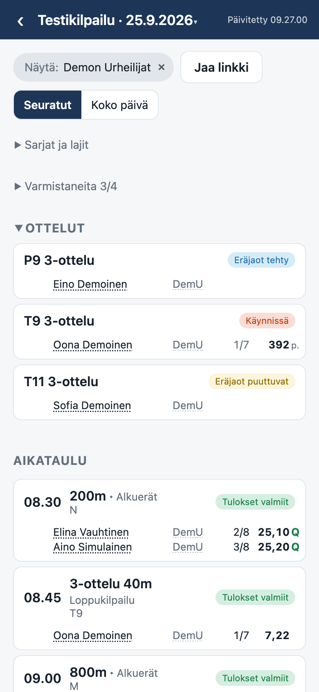
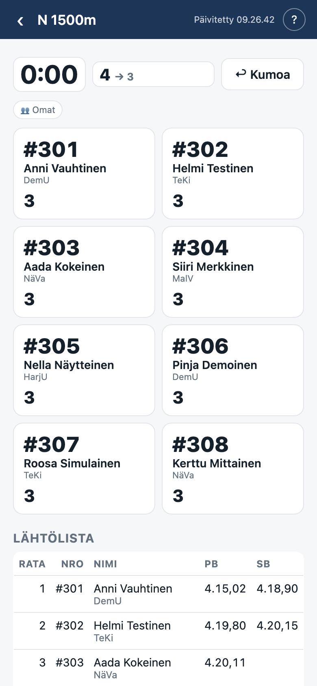

# Kisat

Kisat shows Finnish athletics competitions to people who follow a club or a few athletes. It reads
the schedules and results that [Tuloslista](https://live.tuloslista.com/) publishes, for track and
field events alike. It works on a phone at the track and on a laptop at home. The same code also
serves Juoksut, a mode for the official at the finish line. The app is in Finnish.

<p>
  
  
</p>

Try the demo meet at [kisat.matilainen.fi/demo](https://kisat.matilainen.fi/demo) and
[juoksut.matilainen.fi/demo](https://juoksut.matilainen.fi/demo). Its clubs and athletes are
invented, and its starts are dated today.

## What it does

- **A follow-list holds clubs and athletes.** On each day of a meet, Kisat shows the starts that
  they are in, with their heats, places and results. The same list works in every meet, and the
  front page shows the upcoming meets they are entered in.
- **A follow-list is shared by a link.** There are no accounts. The list stores the names and
  licence numbers of its athletes, which Tuloslista also publishes. A list is deleted 180 days after
  its last change. The site sets no cookies and runs no analytics.
- **Each meet shows its heats, results and field ladders**, its multi-events, its medals per club
  and the standings of a club cup. Some championships publish their results on another site, and
  Kisat reads them from there once the meet is over.
- **Juoksut mode puts the track first.** It adds the lap counter and the setup of each hurdle start,
  taken from the federations' tables.

## How it is built

The app is a static single-page app with no framework. The page runs scripts from its own origin
only. The browser reads Tuloslista's public JSON API directly, the same API that Tuloslista's own
pages use. A small Cloudflare Worker in front of the static files stores the follow-lists. The
Worker also builds and caches data that would take the browser many requests to fetch, such as the
whole roster of a meet.

Kisat is not affiliated with Tuloslista or with the other result sites it reads.

[AGENTS.md](AGENTS.md) maps the code and sets its conventions, and [docs/](docs/) has a document for
each area.

## Running it

A local instance needs Node 24.14 or newer, [pnpm](https://pnpm.io/installation) and `make`. pnpm
installs the pinned tools, and pnpm 10 or newer switches itself to the pnpm version that
`package.json` names. Each `make` target that runs a tool runs `pnpm install` first, so a fresh
clone needs no other setup.

```sh
git clone https://github.com/tmatilai/kisat.git
cd kisat
make dev
```

`make dev` runs the Worker and the page in a local `wrangler dev`. It needs no Cloudflare account,
and it stores its KV in `.wrangler/state`. The demo meets are built in and work offline. Every other
meet is read from Tuloslista's live API. On localhost, `?mode=juoksut` selects Juoksut mode.

| mode    | front page                          | demo meet                                 |
| ------- | ----------------------------------- | ----------------------------------------- |
| Kisat   | http://localhost:8787/              | http://localhost:8787/c/demo              |
| Juoksut | http://localhost:8787/?mode=juoksut | http://localhost:8787/c/demo?mode=juoksut |

The club cup's demo meets are at `/c/democup` and `/c/democupfinal`. `make dev DEV_PORT=8788` uses
another port. `make serve` serves only the files in `public/` at http://localhost:8932/, with Python
3 and no Worker, so `/api` and every path without a file return 404. `make help` lists every target.

## Deployment

One Cloudflare Worker serves both `kisat.matilainen.fi` and `juoksut.matilainen.fi`, and it selects
the mode from the hostname. [docs/deployment.md](docs/deployment.md) describes how the live site is
deployed and what your own deployment needs.

## Contributing

Issues and pull requests are welcome. [CONTRIBUTING.md](CONTRIBUTING.md) describes what an issue
needs, how to prepare a change and which checks a pull request must pass. Everyone taking part
follows the [code of conduct](CODE_OF_CONDUCT.md).

## Contact

Ask questions in an issue. For a private matter, such as a report under the code of conduct, write
to the address shown by the `?` button on the front page of
[kisat.matilainen.fi](https://kisat.matilainen.fi/).

## Licence

[MIT](LICENSE).
